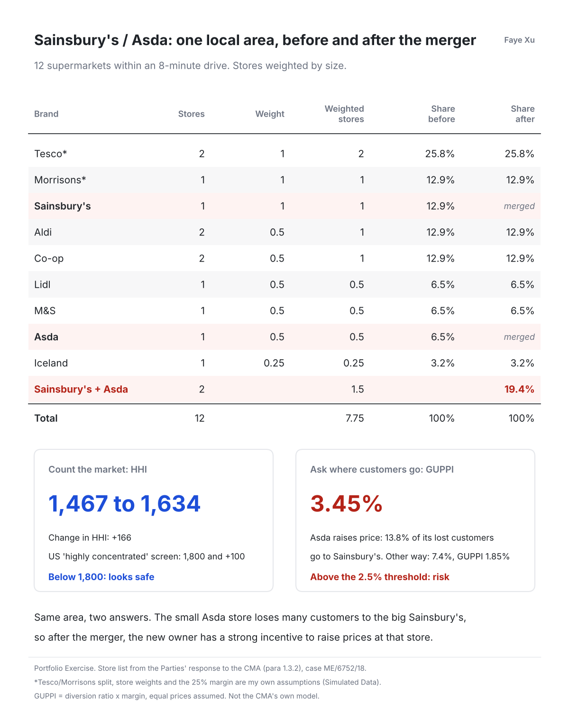

# Sainsbury's / Asda merger: market concentration, GUPPI and margins

A portfolio exercise that tests the UK Competition and Markets Authority's (CMA) 2019 decision to block the Sainsbury's / Asda merger, using only public data.

> **Portfolio Exercise.** This is my own analysis for learning purposes. It is not the CMA's analysis, and some inputs are my own assumptions (marked in the files).

## The question

Should the CMA allow Sainsbury's to merge with Asda? The CMA blocked the deal on 25 April 2019.

## My recommendation

**Block the merger.** The merger would lead to upward pricing pressure both locally and nationally. The remedies offered, selling up to 150 stores and a three-year price pledge, cannot fix a problem that covers 537 local areas and is driven by prices set at head office.

## Key findings

1. **HHI can look safe while GUPPI shows a risk.** In one local area with 12 stores, HHI after the merger is 1,634, below the 1,800 US reference level. But the GUPPI for the small Asda store is 3.45%, above the 2.5% threshold the CMA used.
2. **Diversion is not symmetric.** 13.8% of the Asda store's lost customers would go to the large Sainsbury's, but only 7.4% would go the other way.
3. **The result depends on the margin.** Sainsbury's reports a 6.9% gross margin, but its cost of sales includes all store running costs. Using its own accounts, its variable margin is between 6.9% and 22.6%. The break-even margin is 18.1%, and the evidence suggests the true margin is near the upper end.
4. **Even a small price rise is costly.** A 1% price rise would cost the two firms' customers about £519m a year (likely an overestimate).

## What is in this repository

| File | What it is |
|---|---|
| `Executive_Summary.pdf` | Recommendation, findings, counterarguments, limitations and sources |
| `Sainsburys_Asda_merger_model.xlsx` | The Excel model, with formulas |
| `area_a_hhi_vs_guppi.png` | Summary chart for one local area |

## How to use the model

Open the `README` sheet first. Blue cells are inputs: change them to test the model, and every result updates.

| Sheet | Content |
|---|---|
| `1_HHI` | National HHI and local HHI (count of stores and weighted share of shops) |
| `2_Margins` | Margins from both firms' annual reports, and critical loss |
| `3_GUPPI` | Diversion ratios, GUPPI in both directions, and the break-even margin |
| `4_Sensitivity` | How the local result changes with Sainsbury's margin |
| `5_Consumer_cost` | Extra cost to customers under 1%, 3% and 5% price rise scenarios |

## Method

1. Read the CMA's final report to understand how it defined the market and assessed local areas.
2. Rebuilt one local area from a store list in the Parties' own submission, and calculated HHI by count of stores and by a weighted share of shops.
3. Estimated diversion ratios from the weighted shares, and calculated GUPPI (diversion ratio x the other firm's margin).
4. Estimated variable margins from both firms' annual reports, and tested how the result changes with the margin (break-even and sensitivity analysis).
5. Estimated the cost to customers under three price rise scenarios.

## Main limitations

- Public data only. The CMA used internal data from both firms.
- Store weights, the Tesco / Morrisons split and some margins are my own assumptions.
- One local area only, out of 1,239 where both firms were present.
- GUPPI measures pricing pressure, not the actual price rise.
- The consumer cost uses total revenue, which includes fuel, Argos and banking, so it likely overstates the effect.

## Sources

- CMA, [Sainsbury's / Asda final report](https://assets.publishing.service.gov.uk/media/5cc1ec1340f0b64031cfa6f0/Final_reportSA.pdf) and [summary](https://assets.publishing.service.gov.uk/media/5cc1434ee5274a467a8dd482/Executive_summary.pdf), 25 April 2019
- [Parties' Response to the Notice of Possible Remedies](https://assets.publishing.service.gov.uk/media/5c93799a40f0b633f8327432/Parties_response_to_the_NPR_pdf.pdf), 6 March 2019, para 1.3.2
- AlixPartners, [submission on the appropriate application of GUPPI](https://assets.publishing.service.gov.uk/media/5c926af9ed915d07aab51544/Alix_Partners_response_to_PFs.pdf), 13 March 2019
- CMA, [Merger Assessment Guidelines (CMA129)](https://assets.publishing.service.gov.uk/media/6a9839595a0c25165ae467fd/merger_assessment_guidelines.pdf)
- [J Sainsbury plc Annual Report and Financial Statements 2019](https://corporate.sainsburys.co.uk/media/3o3h4joj/sainsburys_ar2019.pdf)
- [ASDA Group Limited, Reports and Financial Statements, 31 December 2018](https://find-and-update.company-information.service.gov.uk/company/01396513/filing-history), Companies House

## About me

I am Faye Xu, an economics graduate (MSc International Economics, Banking and Finance, Cardiff University, Distinction) based in London, interested in competition economics and economic consulting.

[LinkedIn](https://www.linkedin.com/in/fanqiaofayexu)
